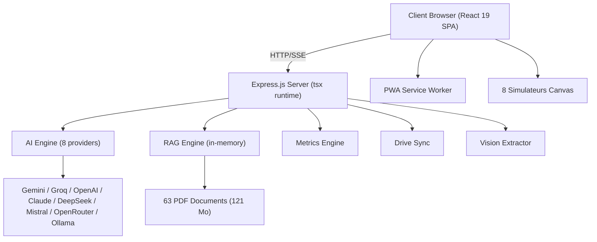
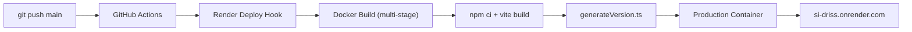

# 🔬 Analyse Complète — Application Si Driss v2.2.0

> **Date :** 24 Novembre 2026  
> **Branche Git :** `main` — Commit `c7b7d9e`  
> **Déploiement :** [si-driss.onrender.com](https://si-driss.onrender.com)  
> **Repository :** [github.com/Zinessabah/Si-Driss](https://github.com/Zinessabah/Si-Driss)

---

## 1. Vue d'Ensemble

**Si Driss** est une plateforme éducative complète de Physique-Chimie pour les élèves de **2ème Bac BIOF** (Sciences Physiques PC & Sciences Mathématiques SM) au Maroc. L'application simule un professeur virtuel nommé "Si Driss" (Prof Driss), capable de coaching socratique, correction d'examens nationaux, tracé de courbes interactives et simulation de laboratoires virtuels.

### Statistiques du Code

| Métrique | Valeur |
|---|---|
| **Lignes de code (TS/TSX)** | **29 711** |
| **Fichiers Frontend** (src/) | 48 fichiers `.ts` / `.tsx` |
| **Fichiers Backend** (server/) | 18 fichiers `.ts` |
| **Composants React** | 30 composants `.tsx` |
| **Documents PDF** (docs/) | **121 Mo** (63 documents programme) |
| **Bundle dist/** | 4,9 Mo |
| **Dépendances** (node_modules/) | ~518 Mo |

---

## 2. Architecture



### Stack Technique

| Couche | Technologies |
|---|---|
| **Frontend** | React 19, Vite 8, TailwindCSS 4, KaTeX, DOMPurify, Lucide Icons |
| **Backend** | Express 4, TypeScript (strict), tsx runtime (Node 22) |
| **IA** | Google GenAI SDK, Anthropic API, OpenAI-compatible (Groq, DeepSeek, Mistral, OpenRouter, Ollama) |
| **RAG** | pdf-parse, extraction texte/vision in-memory, normalisation NFKC arabe |
| **Export** | jsPDF, docx, html2canvas |
| **PWA** | vite-plugin-pwa, Workbox |
| **Build** | Vite 8, Docker multi-stage (Node 22 Alpine) |
| **CI/CD** | GitHub Actions → Render Deploy Hook |

### Architecture Monorepo

```
Si-Driss/
├── server.ts              # Point d'entrée Express (110 lignes)
├── server/
│   ├── config.ts          # Variables d'environnement (40 lignes)
│   ├── security.ts        # Rate limiting, tokens, CORS (72 lignes)
│   ├── metrics.ts         # Télémétrie anonyme (481 lignes)
│   ├── prompts.ts         # Système pédagogique (202 lignes)
│   ├── rag.ts             # Moteur RAG in-memory (1 495 lignes)
│   ├── driveSync.ts       # Sync Google Drive (574 lignes)
│   ├── visionExtractor.ts # Extraction vision PDF (268 lignes)
│   ├── ai/
│   │   ├── providers.ts   # Résolution providers (249 lignes)
│   │   ├── completion.ts  # Moteur de complétion unifié (459 lignes)
│   │   ├── adapters.ts    # Adaptateurs format messages (272 lignes)
│   │   └── sse.ts         # Parser SSE partagé (55 lignes)
│   └── routes/
│       ├── ai.ts          # Chat/Stream/Evaluate (599 lignes)
│       ├── documents.ts   # Gestion RAG docs (564 lignes)
│       └── admin.ts       # Routes admin (100 lignes)
├── src/
│   ├── App.tsx            # Composant principal (~510 lignes)
│   ├── components/        # 30 composants React
│   ├── hooks/             # Hooks personnalisés
│   ├── data/              # Données statiques (formules, exercices, pièges)
│   ├── types/             # Types TypeScript
│   └── utils/             # Utilitaires (export, stockage)
└── docs/programme/        # 63 PDF programme officiel
```

---

## 3. Inventaire des Fonctionnalités

### 3.1 Chat Socratique IA (SocraticChat.tsx — 1 522 lignes)

> [!IMPORTANT]
> Le cœur de l'application : un chat IA pédagogique avec 4 modes de coaching.

- **4 modes de coaching** : Socratique (questions directrices), Direct (résolution complète), Audit (correction barème), Pièges (flashcards erreurs)
- **Streaming SSE** temps réel avec throttle `requestAnimationFrame` (H3/H8)
- **Pièces jointes** : images (compression JPEG auto 1280px), PDF, texte (3 max/msg, 5 Mo max)
- **Rendu scientifique** : KaTeX LaTeX, courbes SVG interactives, cartes mentales, schémas SVG
- **Historique** : sessions auto-sauvegardées dans localStorage, groupées chronologiquement (style Gemini)
- **Fallback non-streaming** si le flux SSE échoue silencieusement
- **Abort controller** : timeout 120s d'inactivité, annulation au démontage

### 3.2 Moteur IA Multi-Provider (8 fournisseurs)

| Provider | Modèle par défaut | Spécificité |
|---|---|---|
| **Google Gemini** | gemini-4-hydrogen | Vision multimodale, failover automatique sur modèles rapides |
| **Groq** | llama-4-scout-17b-16e-instruct | Ultra-rapide (~300 t/s) |
| **OpenAI** | gpt-4.1-mini | Standard ChatGPT |
| **Anthropic Claude** | claude-sonnet-4-20250514 | Audit de rédaction |
| **DeepSeek** | deepseek-flash | Raisonnement avec `reasoning_effort` |
| **Mistral** | mistral-large-latest | Modèle européen |
| **OpenRouter** | google/gemini-4-flash-thinking | Agrégateur multi-modèles |
| **Ollama** | llama3.1:latest | 100% hors-ligne |

**Architecture robuste :**
- **Failover Gemini** : rotation automatique entre modèles candidats (2 rounds max)
- **Retry transient** : HTTP 429/502/503/504 avec `Retry-After` / backoff exponentiel
- **Parser SSE partagé** (`pipeSseEvents`) : supprime la duplication de code entre providers
- **Adaptateurs de messages** : formatage spécifique Gemini (turn alternation), Anthropic (strict alternation), OpenAI (system message)
- **SSRF protection** : validation des base URLs personnalisées (loopback/RFC1918 uniquement)

### 3.3 Système RAG (rag.ts — 1 495 lignes)

> [!NOTE]
> RAG 100% local, in-memory, avec étanchéité stricte entre branches PC et SM.

- **63 documents indexés** : 59 PC + 4 SM
- **Extraction texte** : pdf-parse pour PDF natifs, Vision Gemini pour PDF scannés
- **Normalisation arabe** : NFKC + suppression tashkeel (diacritiques)
- **Recherche par similarité** : cosinus TF-IDF sur chunks de 500-800 mots
- **Étanchéité pédagogique** : un élève PC ne voit jamais les documents SM et vice-versa
- **Extraction vision** : décodage des schémas de montage, circuits, oscillogrammes via Gemini multimodal
- **Google Drive auto-sync** : bi-quotidien (toutes les 12h), déduplication SHA-256

### 3.4 Laboratoires Virtuels (8 simulateurs)

| Simulateur | Description | Fichier |
|---|---|---|
| **Ondes mécaniques** | Propagation, célérité, retard | WaveSimulator.tsx |
| **Diffraction** | Fente simple, λ/a | DiffractionSimulator.tsx |
| **Dispersion** | Prisme, spectre | DispersionSimulator.tsx |
| **Circuit RLC** | Oscillations libres, amorties | RLCSimulator.tsx |
| **Circuit RC-EXAO** | Charge/décharge condensateur | RCExAOSimulator.tsx |
| **Modulation AM** | Signal porteur + modulant | AMModulationSimulator.tsx |
| **Mécanique / Chute** | Newton, frottement, Euler | MechanicsSimulator.tsx |
| **Titrage** | pH-métrique, conductimétrique | TitrationSimulator.tsx |

Tous les simulateurs utilisent **Canvas + requestAnimationFrame** et sont **lazy-loaded** via `React.lazy()`.

### 3.5 Autres Fonctionnalités

- **Mémento & Formules** (FormulaCheatSheet.tsx) : Cadre de référence complet 2BAC, calculateur express interactif, historique des calculs
- **Audit de Rédaction** (AuditWorkspace.tsx) : correction IA de copies selon barème national, confetti pour notes ≥ 16/20
- **Pièges du National** (pitfalls.ts) : flashcards des erreurs récurrentes par chapitre
- **Exercices Nationaux** (nationalExercises.ts) : base de données d'exercices type Bac
- **Export** (documentExporter.ts — 1 538 lignes) : PDF (jsPDF) + DOCX (docx), conversion LaTeX→Unicode exhaustive
- **Visionneuse d'Examens** (OfficialExamPageViewer.tsx) : navigateur de pages PDF avec zoom
- **Courbes Interactives** (ScientificGraphicsRenderer.tsx — 1 304 lignes) : tracé SVG avec zoom, survol coordonnées, téléchargement SVG, parseur d'expressions mathématiques sans `eval`
- **Cartes Mentales** : génération dynamique depuis Mermaid ou listes indentées
- **Installation PWA** : fonctionne hors-ligne sur mobile (iPhone/Android)
- **Système de version** : vérification automatique cloud vs local avec bannière de mise à jour

---

## 4. Qualité du Code

### 4.1 TypeScript

> [!TIP]
> `strict: true` dans tsconfig.json — c'est une excellente pratique.

- **Mode strict activé** ✅ : `strict: true`, `isolatedModules: true`
- **Target** : ES2022
- **Lint** : `tsc --noEmit` uniquement (pas d'ESLint configuré)
- **0 erreurs de compilation** au dernier build

### 4.2 Points Forts

| Aspect | Évaluation | Détail |
|---|---|---|
| **Sécurité LaTeX** | ✅ Excellent | `trust: false` dans KaTeX + DOMPurify sur le HTML généré |
| **Sécurité tokens** | ✅ Excellent | Comparaison temps constant via SHA-256 (`safeTokenEqual`) |
| **Rate limiting** | ✅ Bon | 3 limiteurs distincts (API, validation, mutation) |
| **Code splitting** | ✅ Bon | 13 composants lazy-loaded, chunks manuels (react, katex) |
| **Streaming** | ✅ Excellent | Parser SSE factorisé, throttle rAF, abort propre |
| **Parseur math** | ✅ Excellent | Évaluateur récursif sécurisé (sans `eval`/`Function`) |
| **Stockage** | ✅ Bon | Élagage auto localStorage (3 niveaux de dégradation gracieuse) |
| **Prompt engineering** | ✅ Excellent | 202 lignes de system prompt rigoureux, conforme au cadre officiel MEN |
| **Failover IA** | ✅ Excellent | Rotation modèles, retry transient, détection erreurs fatales |

### 4.3 Points d'Amélioration

| Aspect | Évaluation | Recommandation |
|---|---|---|
| **Tests** | ❌ Absent | Aucun test unitaire, d'intégration ou E2E |
| **ESLint** | ⚠️ Absent | Pas de linter au-delà de `tsc --noEmit` |
| **Taille du bundle export** | ⚠️ 850 Ko | Chunk `documentExporter` volumineux (jspdf + docx) |
| **Duplications KaTeX** | ⚠️ Mineure | `KATEX_MACROS` dupliqué entre MathView.tsx et ScientificGraphicsRenderer.tsx |
| **Fichier unique** | ⚠️ Large | SocraticChat.tsx (1 522 lignes) et documentExporter.ts (1 538 lignes) pourraient être découpés |
| **Code mort** | ⚠️ Résiduel | Référence à `SessionManagerModal.tsx` dans les commentaires (`chat.ts` ligne 3) |

---

## 5. Sécurité

### 5.1 Protections Implémentées ✅

| Mécanisme | Implémentation |
|---|---|
| **Rate Limiting** | `express-rate-limit` : 300 req/5min (API), 10 req/10min (validation clé), 30 req/10min (mutations documents) |
| **Token de classe** | `SI_DRISS_ACCESS_TOKEN` optionnel, comparaison temps constant SHA-256 |
| **Token admin** | `ADMIN_TOKEN` pour mutations documents, refusé en production si absent |
| **CORS admin** | Routes admin restreintes aux origines whitelist |
| **Path traversal** | Validation des chemins de fichiers dans les routes documents |
| **SSRF** | Validation des base URLs personnalisées (interdit loopback/RFC1918) |
| **XSS LaTeX** | `trust: false` dans KaTeX + sanitisation DOMPurify |
| **Injection prompt** | Règle de sécurité explicite dans le system prompt |
| **Anonymisation** | IP hachées SHA-256 pour les visiteurs quotidiens |

### 5.2 Risques Identifiés

> [!WARNING]
> Points nécessitant attention.

1. **Fichier `.env` avec clés potentiellement exposées** — Les clés API semblent vides au chargement (`length: 0`), possiblement à cause de guillemets dans le `.env`. Vérifier le format.
2. **Pas d'authentification utilisateur** — Au-delà du mot de passe de classe optionnel, il n'y a pas de système d'authentification individuel (login/mot de passe ou OAuth).
3. **localStorage non chiffré** — Les sessions de chat (incluant les pièces jointes base64) sont stockées en clair dans le navigateur.
4. **Admin token en production** — Si `ADMIN_TOKEN` n'est pas configuré, les routes de mutation sont bloquées (503) — c'est un bon garde-fou.

---

## 6. Performance

### 6.1 Optimisations Frontend

| Technique | Détail |
|---|---|
| **React.lazy** | 13 composants chargés à la demande |
| **React.memo** | `MathView`, `KatexContainer` mémoïsés |
| **useMemo** | Rendu KaTeX, chemins SVG, listes filtrées |
| **rAF throttle** | Streaming chat : 1 setState/frame au lieu de 1/chunk |
| **Compression images** | Auto-resize 1280px + JPEG quality 0.75 |
| **PWA** | 81 entries précachées, 3,2 Mo |
| **Chunks Vite** | Séparation manuelle : react, katex, vendors |

### 6.2 Optimisations Backend

| Technique | Détail |
|---|---|
| **RAG in-memory** | TF-IDF pré-calculé au démarrage, recherche O(n) |
| **Metrics debounce** | Sauvegarde différée (2s) pour éviter l'écriture à chaque requête |
| **SSE shared parser** | `pipeSseEvents` factorisé pour tous les providers |
| **Abort signals** | Timeout 180s upstream, 120s inactivité client |
| **Drive retry** | Backoff exponentiel avec jitter, timeout 25s |

### 6.3 Bundle Analysis

| Chunk | Taille estimée |
|---|---|
| **Main app** | ~1,2 Mo (gzipped ~400 Ko) |
| **documentExporter** | ~850 Ko (jspdf + docx) |
| **react vendor** | ~150 Ko |
| **katex** | ~600 Ko (CSS + fonts) |
| **PWA total** | 3,2 Mo (81 entries) |

---

## 7. Scalabilité

### 7.1 Limitations Actuelles

> [!CAUTION]
> L'architecture actuelle a des limites de scalabilité importantes.

| Contrainte | Impact | Seuil |
|---|---|---|
| **Render Free Tier** | 512 Mo RAM, cold starts | ~20-30 utilisateurs simultanés |
| **Pas de base de données** | État en mémoire (metrics, RAG), localStorage (sessions) | Perte de données au redémarrage |
| **Single instance** | Pas de load balancing | 1 seul worker |
| **121 Mo de PDFs dans Git** | Clone et deploy lents | Chaque push transfère tout |
| **RAG in-memory** | Chargement intégral des 63 docs au démarrage | RAM proportionnelle aux docs |

### 7.2 Estimation de Capacité

| Tier | Utilisateurs simultanés | RAM estimée |
|---|---|---|
| **Render Free** | 10-20 | 512 Mo |
| **Render Starter (\$7/mois)** | 30-50 | 1 Go |
| **Render Standard (\$25/mois)** | 50-100 | 2 Go |
| **VPS / Docker** | 100-300 | 4 Go |
| **Avec base de données + CDN** | 500+ | Variable |

---

## 8. DevOps

### 8.1 Pipeline de Build



### 8.2 Système de Version

Implémenté en 3 niveaux :
1. **Terminal** (`start.sh`) : vérifie le commit local vs cloud au démarrage
2. **Serveur** (`server/version.ts`) : expose `/api/version` avec hash git
3. **UI** (`CloudUpdateBanner.tsx`) : bannière avec bouton 1-click `git pull`

### 8.3 Docker

```dockerfile
# Multi-stage : Node 22 Alpine
FROM node:22-alpine AS build  → npm ci + vite build
FROM node:22-alpine AS prod   → Copie dist/ + version.json + docs/
```

---

## 9. Système Pédagogique

> [!NOTE]
> L'une des forces majeures de l'application : un system prompt de **202 lignes** parfaitement calibré pour le programme marocain.

### 9.1 Conformité Curriculum

- **Cadre de Référence MEN** : spécificités PC et SM exhaustivement documentées dans le prompt
- **Étanchéité PC/SM** : régimes sinusoïdaux forcés et champ électrique $\vec{E}$ exclusifs SM
- **Spectrophotométrie explicitement exclue** (programme français, pas marocain)
- **5 méthodes de suivi cinétique** officielles

### 9.2 Consignes Critiques (3 règles d'or)

1. **Interdiction d'inventer des données** : si une valeur manque dans l'énoncé, le prof signale et donne l'expression littérale
2. **Protocole de résolution en 4 étapes** : Principe → Littéral → AN → Contrôle
3. **Génération automatique de courbes** : blocs ` ```curve ` / ` ```mindmap ` / ` ```svg ` détectés et rendus en SVG interactif

### 9.3 Gestion des Corrigés

- En **mode Socratique** : corrigé confidentiel, utilisé uniquement comme guide de contrôle interne
- En **mode Direct** : exposition fidèle de la méthode modèle

---

## 10. Recommandations & Roadmap

### 🔴 Priorité Haute

| # | Action | Impact |
|---|---|---|
| 1 | **Ajouter des tests** (Vitest + React Testing Library) | Fiabilité, régression |
| 2 | **Migrer docs/ vers Git LFS** ou CDN | Build 10x plus rapide |
| 3 | **Ajouter ESLint** (eslint-config-react) | Qualité, conventions |
| 4 | **Vérifier le fichier `.env`** | Les clés API semblent vides |

### 🟡 Priorité Moyenne

| # | Action | Impact |
|---|---|---|
| 5 | **Base de données** (SQLite/Turso minimum) | Persistance métriques, sessions côté serveur |
| 6 | **Découper SocraticChat.tsx** (1 522 lignes) | Maintenabilité |
| 7 | **Lazy-load documentExporter** | Réduire le bundle initial de 850 Ko |
| 8 | **Factoriser KATEX_MACROS** | Éliminer la duplication |
| 9 | **Authentification individuelle** | OAuth / JWT pour suivi par élève |

### 🟢 Priorité Basse

| # | Action | Impact |
|---|---|---|
| 10 | **Monitoring (Sentry)** | Détection erreurs production |
| 11 | **i18n** (français/arabe/anglais) | Accessibilité |
| 12 | **Mode examen** (hors-ligne, chronométré) | Préparation Bac |
| 13 | **Analytics élèves** | Tableau de bord progression par chapitre |
| 14 | **Upgrade vers Render payant** | Scalabilité pour déploiement national |

---

## 11. Conclusion

**Si Driss est une application éducative remarquablement complète et bien conçue.** Pour un projet développé par un professeur pour ses élèves, le niveau technique est excellent :

- ✅ Architecture multi-provider IA robuste avec failover et retry
- ✅ Système RAG local avec étanchéité pédagogique PC/SM
- ✅ System prompt de 202 lignes parfaitement calibré sur le programme officiel
- ✅ Rendu scientifique avancé (LaTeX, courbes SVG interactives, cartes mentales)
- ✅ 8 simulateurs de laboratoire virtuel
- ✅ Sécurité bien pensée (rate limiting, tokens temps constant, SSRF, XSS)
- ✅ PWA installable avec fonctionnement hors-ligne
- ✅ TypeScript strict sur ~30 000 lignes

Les principaux axes d'amélioration sont : l'ajout de **tests automatisés**, la migration vers **Git LFS** pour les 121 Mo de PDFs, et l'adoption d'une **base de données** pour la persistance côté serveur. Ces améliorations transformeraient Si Driss d'un projet personnel excellent en une plateforme éducative nationale prête pour le déploiement à grande échelle.

> *Tbarkellah 3lik, Si Driss ! L'application est solide comme un roc.* 🎓
